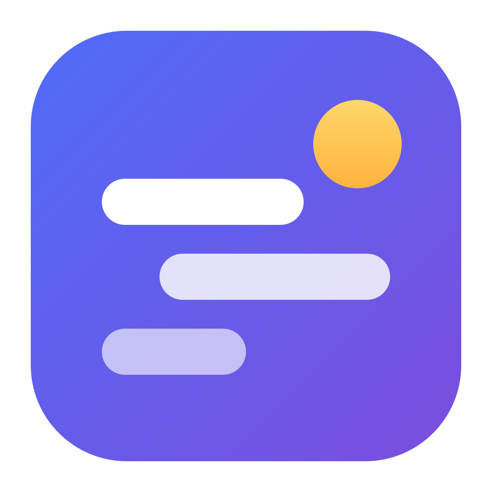

<p align="center"></p>

# Hibi

**日本語** ([README.md](README.md)) · **English** (this file) · **中文** ([README.zh.md](README.zh.md))

A personal work-tracking app that brings what you did on your PC and what your AI agents did together into a single timeline. An AI reads your screen to record "what you are doing right now", and from each day's records it writes a daily report and a blog post.

**Documentation: https://kling0012.github.io/hibi/en/**

> **This project is based on [volcengine/MineContext](https://github.com/volcengine/MineContext).**
> The original project is published under Apache License 2.0, and this repository follows the same license ([LICENSE](LICENSE)).
> It is a different app with substantial changes to the name, UI, AI connection scheme, and recording mechanism. The original README is kept at [docs/upstream/](docs/upstream/README.md).

## The three repositories that make up Hibi

| Repository | Role |
|---|---|
| **hibi** (this repo) | Desktop app (Apple silicon Mac / Windows). Screen recording, declaring work, viewing |
| [hibi-server](https://github.com/Kling0012/hibi-server) | Sync server. Record aggregation, search, work-end detection, daily report / blog, mobile-friendly views |
| [hibi-memory](https://github.com/Kling0012/hibi-memory) | Shared memory for AI. Where AI agents leave their work records |

## What it can do

- **Screen recording** — Sends the screen to an AI at up to one frame per second, keeping 30-second activity summaries plus accurate transcriptions whenever the screen changes. Password managers and other apps can be excluded.
- **Automatic AI failover** — Prefers Gemini Live (free tier) and automatically switches to GLM and other OpenAI-compatible APIs on limits or failures.
- **Declaring work** — Start by writing "I'm about to do X"; the AI later decides from the screen when it finished, preserving the time spent.
- **Timeline** — Lays out the day in lanes per work, device, and AI, with a one-month heatmap for looking back.
- **To-dos** — Automatically adds time spent from your records to to-dos you add yourself.
- **Away detection** — Pauses recording after a while without input and deducts time away from work time.
- **Share your work** — Choose a period and items to include, turn them into a single image, and post it to X.
- **Daily report and blog** — Every night the AI writes a daily report from that day's records and drafts blog posts. You can also have Claude Code write via MCP.
- **From anywhere** — Records are collected on your own sync server, so the same records are visible from another PC, a phone, or an iPad.
- **Japanese, English, and Chinese** — The UI and documentation support all three languages.

## Getting started

1. Set up the sync server ([hibi-server](https://github.com/Kling0012/hibi-server))
2. Install the app from [Releases](https://github.com/Kling0012/hibi/releases)
   - macOS builds are unsigned; run `xattr -dr com.apple.quarantine /Applications/Hibi.app` once
3. In the first-run setup screen, enter the AI connections and the sync server URL

See [Setup](https://kling0012.github.io/hibi/en/getting-started.html) for details.

## Development

Requirements: Python 3.12 with [uv](https://docs.astral.sh/uv/), Node.js 22 or newer with pnpm 10.

```sh
uv sync
uv run python -m opencontext.cli start   # Python backend (127.0.0.1:1733)
cd frontend && pnpm install && pnpm run dev
```

| Directory | Contents |
|---|---|
| `frontend/` | The Electron 44 + React 19 app itself |
| `opencontext/` | The bundled Python backend (AI screen summaries, to-dos / hints, sending to the sync server) |
| `config/` | Default settings (`config.yaml`) |
| `docs/` | Documentation site (GitHub Pages) |

Release builds run on each OS because the Python part is bundled with PyInstaller. Running the GitHub Actions `release.yml` manually builds the macOS (Apple silicon) and Windows versions and attaches them to a draft release.

```sh
gh workflow run release.yml -R Kling0012/hibi -f tag=v0.1.0
```

## Main changes from the original project

- Renamed to Hibi with a new icon (existing MineContext data is migrated on first launch)
- UI localized to Japanese; sidebar, home screen, and settings rebuilt
- AI now chosen per purpose from multiple connections, with automatic failover (Gemini Live, OpenAI-compatible)
- Screen recording is now two-stage: continuous streaming to the Live API plus accurate transcription on change
- Added sending to the sync server, declaring work, and views of the sync server (timeline, daily report, blog, search)
- Removed folder / document / web-page ingestion, Doubao / Ark, completion features, the old web UI, screenshot analysis, and in-app vector search (chromadb)
- Updated to Electron 44, React 19, TypeScript 7, Python 3.12 / uv

## License

Apache License 2.0. Copyright notices of the original project are preserved in each file and in [LICENSE](LICENSE).
